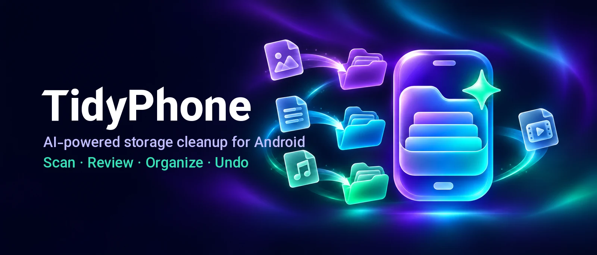
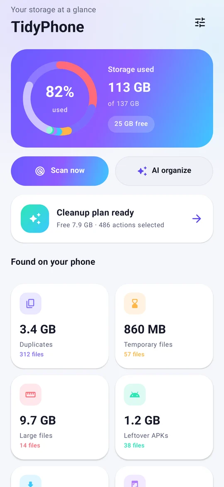
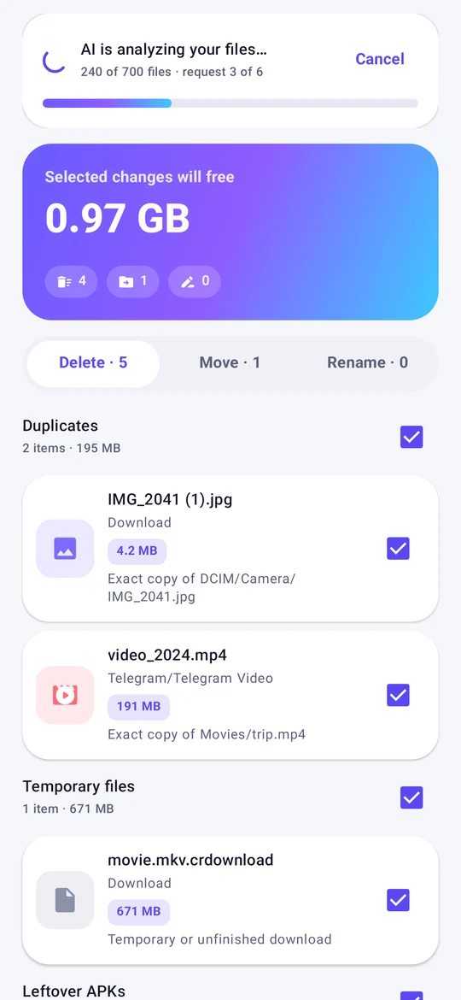
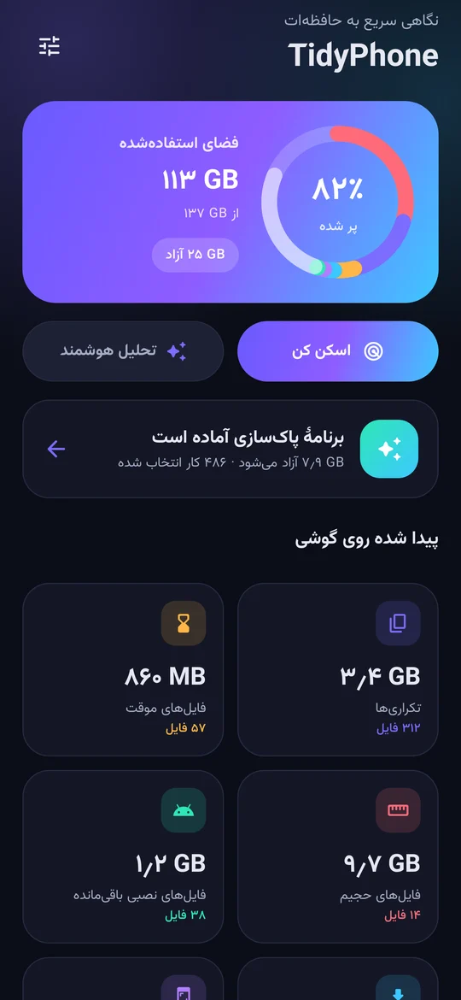
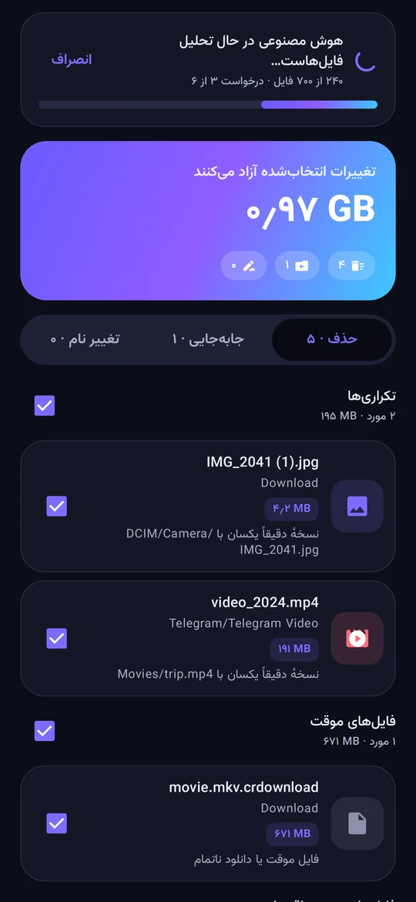
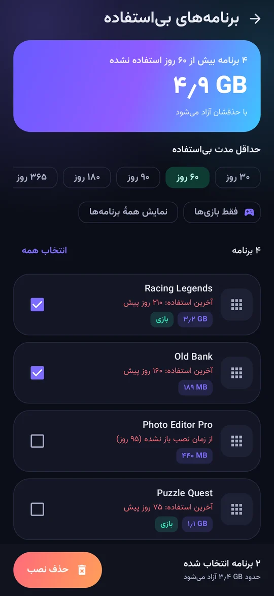

<p align="center">
  
</p>

<h1 align="center">TidyPhone</h1>

<p align="center">
  <b>An Android app that uses an LLM to suggest cleanup and organize the files on your phone, while you stay in control.</b><br>
  <a href="#english">English</a> · <a href="#فارسی">فارسی</a>
</p>

<p align="center">
  
  
  
  
  
</p>

---

<a name="english"></a>

## English

### What it does

| | |
|---|---|
| **Scan** | Indexes shared storage (Download, DCIM, Pictures, Documents, Movies, Music, WhatsApp/Telegram media, …): path, name, size, MIME type, dates. SHA-256 is computed only for files whose size matches another file. Runs as a foreground WorkManager job. |
| **On-device analysis** | Exact duplicates, large files (configurable threshold), old downloads, leftover APKs, empty folders, temporary and partial files, old screenshots. No network needed. |
| **LLM analysis** | Sends **metadata only** (relative path, size, type, date) in token-budgeted batches. The model returns JSON with a category, target folder, a "safe to delete?" flag with a reason, and an optional clean rename. The answer is validated against a JSON Schema; bad output is retried once, then the batch is skipped. A token and cost estimate is shown before every run. |
| **Content analysis (opt-in)** | Off by default and enabled **per run** after a privacy warning: sends 256 px thumbnails (photos, a video frame, the first page of PDFs) and the first lines of text files. |
| **Review** | The plan is grouped by Delete / Move / Rename with checkboxes, previews, reasons and the total space to free. Nothing happens until you tap **Apply** and confirm. |
| **Execute & undo** | "Delete" moves files to an app-managed Trash (`/storage/emulated/0/.TidyPhoneTrash`). The Trash auto-empties after N days (configurable) or on demand. Every action is recorded in History and can be undone (move back, un-rename, restore), one by one or as a whole run. |
| **Custom rules** | Plain-language instructions ("never touch the Work folder", "put invoices in Documents/Finance") are added to the system prompt. A separate **exclude-folders list is enforced in code**. |
| **Dry run** | Runs every check and shows what would happen, without touching a file. |
| **Skip** | Skip a whole group (e.g. all large files) or swipe away one suggestion. Skipped suggestions don't come back on later scans unless the file changes; restore them in Settings. |
| **Smart photo albums** | Reads capture date and GPS from photo EXIF and video metadata, groups shots on the device into trips (away from your usual area) and months, looks up place names, and lets the AI name each album, e.g. “Kish trip · Aug 2026” or «سفر کیش · مرداد ۱۴۰۵» (Solar Hijri dates are computed locally). Only dates, ~11 km locations and a few file names are sent; without an AI key albums are named on the device. People in photos are never identified. |
| **Unused apps & games** | Uses Android's usage stats (with “Usage access”) to list apps and games not opened for 30–365 days, with their size, and uninstalls the ones you pick through the system uninstall dialog. |
| **Background work** | Scans and AI runs are foreground workers with a wake lock: they keep going with the screen off and show progress in the status bar (a Live Update chip on Android 16+), with Cancel. |

### Safety rules (enforced in code, not just in the prompt)

All of these live in [`PathGuard`](app/src/main/java/app/tidyphone/domain/safety/PathGuard.kt) and are re-checked when the plan is executed:

- Only paths inside primary shared storage are allowed; `..` traversal is normalized away before checking.
- `Android/data`, `Android/obb`, anything else under `Android/` (except `Android/media`, where newer WhatsApp versions keep media), `LOST.DIR` and `.android_secure` are never touched.
- Excluded folders are never scanned, moved, renamed or deleted.
- Root-level standard folders (DCIM, Download, …) are never moved or deleted themselves.
- LLM suggestions with a target outside allowed paths, inside hidden/protected/excluded folders, or with an unsafe file name are **dropped** ([`SuggestionMapper`](app/src/main/java/app/tidyphone/domain/llm/SuggestionMapper.kt)). Renames always keep the original extension.
- Nothing is overwritten: name clashes get a `name (1).ext` style name, on execute and on undo.
- Permanent deletion only ever happens inside the app's own Trash folder.

### LLM providers

`LlmProvider` has two implementations, both on Ktor:

1. **Anthropic Claude** – Messages API (`POST /v1/messages`, `anthropic-version: 2026-10-21`). Pick any model; `claude-opus-5-5`, `claude-sonnet-5-5`, `claude-haiku-5-5` and `claude-fable-5-2` are suggested. Uses structured output (`output_config.format` with the JSON Schema) and falls back automatically if a model doesn't support it.
2. **OpenAI-compatible** – any `/chat/completions` server, with a custom base URL and model name.

| Service | Base URL | Notes |
|---|---|---|
| OpenAI | `https://api.openai.com/v1` | |
| OpenRouter | `https://openrouter.ai/api/v1` | model e.g. `anthropic/claude-sonnet-5-5` |
| Groq | `https://api.groq.com/openai/v1` | |
| Gemini | `https://generativelanguage.googleapis.com/v1beta/openai` | |
| Ollama | `http://<PC-IP>:11434/v1` | no key needed; start Ollama with `OLLAMA_HOST=0.0.0.0` |
| LM Studio | `http://<PC-IP>:1234/v1` | no key needed; turn off "JSON mode" if the server rejects it |

Settings has provider, base URL, model, API key, optional prices per million tokens (used for the estimate when the model isn't in the built-in price list; local servers count as free), max input tokens per request, and a **Test connection** button.

API keys are encrypted with an AES-256-GCM key held in the **Android Keystore** ([`SecureKeyStore`](app/src/main/java/app/tidyphone/data/settings/SecureKeyStore.kt)). Only the ciphertext is stored, it is excluded from backups, and keys are never logged (there is no HTTP logging at all).

### Permissions

TidyPhone uses **`MANAGE_EXTERNAL_STORAGE` ("All files access")**, explained on the onboarding screen, because moving files between arbitrary folders and finding duplicates across all of shared storage isn't possible with scoped storage alone. Denial is handled: the app explains what's missing and re-checks when you come back from system settings. On Android 8–10 it asks for the legacy storage permissions instead.

> **Note:** Google Play restricts `MANAGE_EXTERNAL_STORAGE` to a short list of app types. TidyPhone is meant for **sideloading or F-Droid**, not the Play Store.

### Privacy

- Scanning, hashing and the on-device analysis never leave your phone.
- LLM analysis sends file metadata (relative path, name, size, MIME type, modified date) to the provider **you** configure, and nothing else, unless you enable content analysis for that run.
- Content analysis sends small JPEG thumbnails and up to ~600 characters of text files. It shows a warning first and resets after each run.
- No analytics, no ads, no backend. App data and keys are excluded from Android backups.
- For full privacy, point the OpenAI-compatible provider at a local model (Ollama, LM Studio).

### Build

Requirements: JDK 17+ (21 recommended) and the Android SDK with platform 37.

```bash
git clone https://github.com/GhrezaKh74/tidyphone.git
cd tidyphone
./gradlew assembleDebug          # app/build/outputs/apk/debug/app-debug.apk
./gradlew testDebugUnitTest      # unit tests
adb install app/build/outputs/apk/debug/app-debug.apk
```

Every push runs [GitHub Actions](.github/workflows/android.yml), which runs the unit tests and uploads the debug APK as the `tidyphone-debug-apk` artifact.

Screenshot tests (Robolectric + Roborazzi, English/light and Persian/dark) are opt-in because they download an Android runtime jar:

```bash
./gradlew testDebugUnitTest -Pscreenshots --tests '*ScreenshotTest*'   # writes docs/screenshots/*.png
```

### Tech stack

Kotlin · Jetpack Compose (Material 3) · MVVM · Coroutines/Flow · Room · WorkManager · Hilt · Ktor · kotlinx.serialization · DataStore · Coil 3 · min SDK 26, target SDK 37 · AGP 9.5 · Kotlin 2.4.

### Architecture

```
app/src/main/java/app/tidyphone/
├── domain/              pure Kotlin, no Android dependencies
│   ├── model/           FileEntry, PlanItem, HistoryRecord, TrashItem
│   ├── safety/          PathGuard – every path rule
│   ├── analysis/        DuplicateFinder, LocalAnalyzer
│   ├── llm/             LlmProvider, PromptBuilder, JsonSchema, SuggestionParser,
│   │                    SuggestionMapper, Batcher, Pricing, LlmAnalyzer
│   └── exec/            PlanExecutor, UndoManager, FileOps
├── data/
│   ├── db/              Room entities and DAOs
│   ├── fs/              FileScanner, Hasher, JavaFileOps, StorageLocations
│   ├── llm/             AnthropicProvider, OpenAiCompatProvider, ContentSampler
│   ├── settings/        DataStore settings, Keystore-encrypted keys
│   ├── worker/          ScanWorker, TrashCleanupWorker
│   └── repo/            repositories used by the UI
├── di/                  Hilt modules
└── ui/                  Compose screens, components, theme, navigation
```

Unit tests cover duplicate detection, local analysis, path/rule enforcement, LLM JSON parsing and schema validation, suggestion mapping, batching and pricing, retry/skip logic, the provider request formats (Ktor MockEngine), the scanner, execution, dry run and undo.

### Credits

- App icon, onboarding illustrations and banner generated with Higgsfield.
- [Kharazmi](licenses/Kharazmi-OFL.txt) font (SIL Open Font License 1.1), a derivative of Vazirmatn.

---

<a name="فارسی"></a>

<div dir="rtl">

## فارسی

### تایدی‌فون چه می‌کند؟

| | |
|---|---|
| **اسکن** | حافظهٔ مشترک گوشی (Download، DCIM، Pictures، Documents، Movies، Music، پوشه‌های رسانهٔ واتس‌اپ و تلگرام و…) را فهرست می‌کند: مسیر، نام، حجم، نوع MIME و تاریخ‌ها. هش SHA-256 فقط برای فایل‌هایی حساب می‌شود که حجمشان با فایل دیگری یکی است. |
| **تحلیل روی خود گوشی** | فایل‌های دقیقاً تکراری، فایل‌های حجیم (با آستانهٔ قابل تنظیم)، دانلودهای قدیمی، فایل‌های نصبی (APK) باقی‌مانده، پوشه‌های خالی، فایل‌های موقت و دانلودهای ناتمام، اسکرین‌شات‌های قدیمی. بدون نیاز به اینترنت. |
| **تحلیل با هوش مصنوعی** | **فقط مشخصات فایل‌ها** (مسیر نسبی، حجم، نوع، تاریخ) در دسته‌هایی با سقف توکن فرستاده می‌شود. مدل یک JSON برمی‌گرداند: دسته‌بندی، پوشهٔ مقصد، «حذفش امن است؟» با دلیل، و نام تمیز اختیاری. پاسخ با JSON Schema بررسی می‌شود؛ پاسخ نامعتبر یک بار دوباره درخواست و بعد رد می‌شود. پیش از هر اجرا تعداد توکن و هزینهٔ تقریبی نمایش داده می‌شود. |
| **تحلیل محتوا (اختیاری)** | به‌طور پیش‌فرض خاموش است و فقط **برای همان اجرا** و پس از هشدار حریم خصوصی روشن می‌شود: تصاویر کوچک ۲۵۶ پیکسلی (عکس، یک فریم ویدیو، صفحهٔ اول PDF) و چند خط اول فایل‌های متنی. |
| **بررسی** | برنامه بر اساس حذف / جابه‌جایی / تغییر نام دسته‌بندی می‌شود، با تیک انتخاب، پیش‌نمایش، دلیل و مجموع فضایی که آزاد می‌شود. تا روی **اعمال** نزنی و تأیید نکنی، هیچ اتفاقی نمی‌افتد. |
| **اجرا و بازگردانی** | «حذف» فایل را به سطل زبالهٔ خود برنامه (`.TidyPhoneTrash`) می‌برد. سطل زباله بعد از N روز (قابل تنظیم) یا دستی خالی می‌شود. هر کاری در تاریخچه ثبت می‌شود و قابل بازگردانی است (جابه‌جایی برعکس، برگرداندن نام، بازیابی از سطل زباله)، تک‌تک یا یک‌جا. |
| **قوانین دلخواه** | دستورهای ساده مثل «هرگز به پوشهٔ Work دست نزن» یا «فاکتورها را در Documents/Finance بگذار» به دستورهای سیستمی مدل اضافه می‌شوند. فهرست **پوشه‌های مستثنا در خود کد اجرا می‌شود**، نه فقط در پرامپت. |
| **حالت آزمایشی** | همهٔ بررسی‌ها انجام می‌شود و نتیجه نمایش داده می‌شود، بدون اینکه به فایلی دست زده شود. |
| **رد کردن** | یک گروه کامل (مثلاً همهٔ فایل‌های حجیم) را رد کن یا یک پیشنهاد را با کشیدن کنار بزن. پیشنهادهای ردشده در اسکن‌های بعدی برنمی‌گردند، مگر اینکه فایل تغییر کند. |
| **آلبوم هوشمند عکس‌ها** | تاریخ و مکان گرفته شدن را از EXIF عکس‌ها و مشخصات فیلم‌ها می‌خواند، روی گوشی آن‌ها را به سفرها و ماه‌ها گروه‌بندی می‌کند، نام مکان را پیدا می‌کند و هوش مصنوعی برای هر آلبوم اسم می‌گذارد، مثل «سفر کیش · مرداد ۱۴۰۵» (تاریخ شمسی روی گوشی حساب می‌شود). فقط تاریخ، مکان تقریبی و چند نام فایل فرستاده می‌شود؛ بدون کلید هم اسم‌گذاری روی گوشی انجام می‌شود. چهرهٔ افراد هرگز شناسایی نمی‌شود. |
| **برنامه‌ها و بازی‌های بی‌استفاده** | با «دسترسی به آمار استفاده»، برنامه‌ها و بازی‌هایی را که ۳۰ تا ۳۶۵ روز باز نشده‌اند همراه با حجمشان نشان می‌دهد و با پنجرهٔ حذف نصب اندروید حذفشان می‌کند. |
| **کار در پس‌زمینه** | اسکن و تحلیل هوشمند با صفحهٔ خاموش هم ادامه پیدا می‌کنند و پیشرفتشان در نوار وضعیت دیده می‌شود (در اندروید ۱۶ به‌صورت چیپ Live Update). |

### قوانین ایمنی (در کد)

- فقط مسیرهای داخل حافظهٔ مشترک اصلی مجازند و `..` پیش از بررسی حذف می‌شود.
- `Android/data`، `Android/obb` و هر چیز دیگری زیر `Android/` (به‌جز `Android/media`) هرگز دست نمی‌خورند.
- پوشه‌های مستثنا هرگز اسکن، جابه‌جا، تغییر نام یا حذف نمی‌شوند.
- پیشنهادهای هوش مصنوعی که مقصدشان خارج از مسیرهای مجاز، داخل پوشه‌های مخفی/محافظت‌شده/مستثنا باشد یا نام نامعتبر داشته باشند **کنار گذاشته می‌شوند**. پسوند فایل در تغییر نام همیشه حفظ می‌شود.
- هیچ فایلی رونویسی نمی‌شود؛ در صورت تکراری بودن نام، نامی مثل `name (1).ext` انتخاب می‌شود.
- حذف همیشگی فقط داخل سطل زبالهٔ خود برنامه انجام می‌شود.

### سرویس‌های هوش مصنوعی

۱. **Claude (Anthropic)** با Messages API؛ مدل را خودت انتخاب می‌کنی (پیشنهادها: `claude-opus-5-5`، `claude-sonnet-5-5`، `claude-haiku-5-5`، `claude-fable-5-2`).
۲. **سازگار با OpenAI** با آدرس پایه و نام مدل دلخواه: OpenAI، OpenRouter، Groq، نقطهٔ سازگار Gemini، و سرورهای محلی مثل Ollama ‏(`http://IP:11434/v1`) و LM Studio ‏(`http://IP:1234/v1`).

در تنظیمات: انتخاب سرویس، آدرس پایه، کلید API، نام مدل، قیمت اختیاری برای برآورد هزینه، و دکمهٔ **آزمایش اتصال**. کلیدها با کلید AES-256-GCM در **Android Keystore** رمزگذاری می‌شوند و هرگز در لاگ ثبت نمی‌شوند.

### دسترسی‌ها

تایدی‌فون از **«دسترسی به همهٔ فایل‌ها» (`MANAGE_EXTERNAL_STORAGE`)** استفاده می‌کند و دلیلش را در صفحهٔ شروع توضیح می‌دهد. اگر دسترسی داده نشود، برنامه توضیح می‌دهد چه چیزی کم است و بعد از برگشتن از تنظیمات دوباره بررسی می‌کند.

> **توجه:** گوگل‌پلی استفاده از این دسترسی را محدود کرده است؛ بنابراین تایدی‌فون برای **نصب مستقیم (APK) یا F-Droid** ساخته شده، نه گوگل‌پلی.

### حریم خصوصی

- اسکن، هش و تحلیل محلی هرگز از گوشی خارج نمی‌شوند.
- تحلیل هوشمند فقط مشخصات فایل (مسیر نسبی، نام، حجم، نوع، تاریخ تغییر) را برای سرویسی که **خودت** تنظیم کرده‌ای می‌فرستد، مگر اینکه برای آن اجرا تحلیل محتوا را روشن کنی.
- بدون آمار و ردیابی، بدون تبلیغ، بدون سرور. داده‌ها و کلیدها در پشتیبان‌گیری اندروید قرار نمی‌گیرند.
- برای حریم خصوصی کامل، از یک مدل محلی (Ollama یا LM Studio) استفاده کن.

### ساخت و اجرا

پیش‌نیاز: JDK نسخهٔ ۱۷ یا بالاتر و Android SDK با پلتفرم ۳۷.

</div>

```bash
git clone https://github.com/GhrezaKh74/tidyphone.git
cd tidyphone
./gradlew assembleDebug
./gradlew testDebugUnitTest
adb install app/build/outputs/apk/debug/app-debug.apk
```

<div dir="rtl">

با هر push، گیت‌هاب اکشنز تست‌ها را اجرا می‌کند و APK دیباگ را با نام `tidyphone-debug-apk` به‌عنوان artifact بارگذاری می‌کند.

### اعتبارها

- آیکون برنامه، تصاویر صفحهٔ شروع و بنر با Higgsfield ساخته شده‌اند.
- فونت [خوارزمی](licenses/Kharazmi-OFL.txt) با مجوز SIL Open Font License 1.1.

</div>
